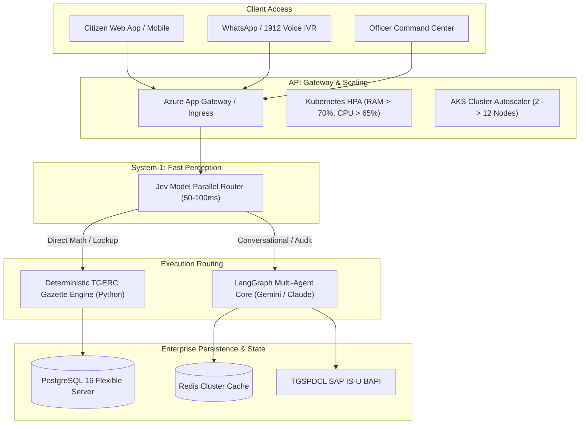

# UrjaMitra AI: System Architecture Specification
**Target Initiative**: AIKAM EnergyTech Innovation Challenge (Dept. of Energy, Govt. of Telangana)  
**Entities**: TGSPDCL & TGNPDCL  
**Document Status**: Baseline Architecture Specification

---

## 1. Executive Architectural Blueprint

UrjaMitra AI enforces a **Tri-Cognitive Architecture**:
1. **System-1 (Jev Decision Router)**: Evaluates input tokens using non-autoregressive parallel decision primitives (Choice, Noul, Score) in **50–100ms** to bypass LLM latency and avoid output token expenses.
2. **System-0 (Deterministic Python Engine)**: 100% mathematical certainty enforcing official TGERC Retail Supply Gazette formulas and Gruha Jyothi subsidy thresholds.
3. **System-2 (LangGraph Multi-Agent Workflows)**: Manages empathetic vernacular conversation, multimodal LCD meter OCR extraction, and SAP IS-U BAPI dispute creation.

---

## 2. Jev Model Token Redirection Specifications

Instead of invoking an autoregressive LLM to parse user intent into JSON, incoming states are evaluated across three typed Jev primitives:

- **`Choice` Primitive**:
  - `intent_type`: `[BILL_BREAKDOWN, METER_READING_AUDIT, SUBSIDY_ADVISORY, OFFICIAL_DISPUTE, GENERAL_FAQ]`
- **`Noul` Primitive**:
  - `bypass_llm`: Returns `True` if numerical arguments are provided, routing directly to the deterministic Python engine in <10ms.
- **`Score` Primitive**:
  - `dispute_severity`: Evaluated on a 1–10 scale. Scores $\ge 7$ trigger human-in-the-loop review in the Officer Command Center.

---

## 3. Elastic Autoscaling on Azure Kubernetes Service (AKS)

To accommodate sudden spikes on bill dispatch day (100 → 1,000 → 10,000+ concurrent requests):

1. **Pod Scaling (HPA)**:
   - Evaluates CPU and RAM metrics every 15 seconds.
   - When memory crosses 70% or CPU crosses 65%, scales replicas from 3 up to 50 pods.
   - Scale-down uses a 300-second stabilization window to prevent flapping.
2. **Node Scaling (Cluster Autoscaler)**:
   - When pods enter `Pending` state, AKS requests additional `Standard_D4s_v5` VM instances, expanding from 2 baseline nodes up to 12 nodes.
   - Once traffic normalizes, idle VMs are drained and deallocated.
