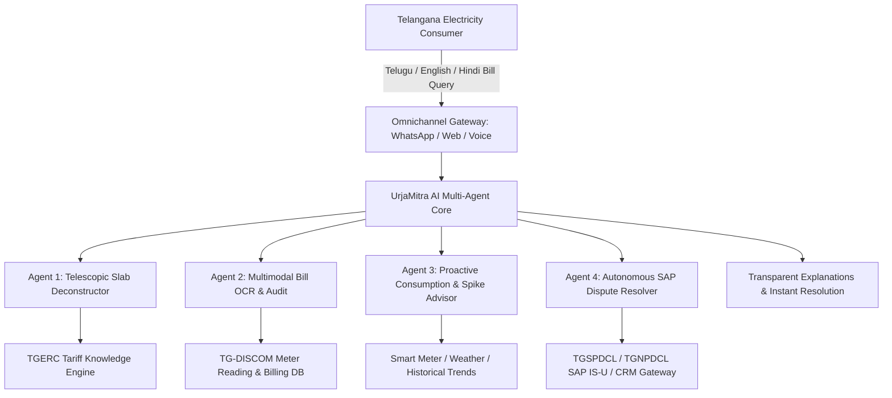

# 1. Executive Summary & Context

## 1.1 Program Background
The Government of Telangana, in collaboration with AIKAM and the Department of Energy, has launched the EnergyTech Innovation Challenge to deploy cutting-edge artificial intelligence across the state’s twin electricity distribution companies (DISCOMs):
1. **TGSPDCL** (Telangana Southern Power Distribution Company Limited — covering Hyderabad, Rangareddy, Medchal, Mahabubnagar, Nalgonda, etc.)
2. **TGNPDCL** (Telangana Northern Power Distribution Company Limited — covering Warangal, Karimnagar, Nizamabad, Khammam, Adilabad, etc.)

Across more than **1.75 crore (17.5 Million)** registered electricity consumers in Telangana, billing inquiries, tariff confusion, bill-shock disputes, and meter-reading discrepancy tickets represent over **68% of all inbound calls** to the state utility helpline `1912` and customer care centers.

## 1.2 The UrjaMitra AI Mission
**UrjaMitra AI (ఉర్జామిత్ర)** is an autonomous, multi-agent conversational and billing copilot engineered specifically for Telangana power utilities. It bridges the deep communication gap between complex regulatory tariff structures (TGERC Tariff Orders, telescopic domestic slabs, Gruha Jyothi zero-bill eligibility, fuel surcharge adjustments/true-up charges) and everyday citizens across urban, peri-urban, and rural Telangana.

By integrating **Multimodal Computer Vision (Bill OCR)**, **Deterministic Tariff Calculation Engines**, **Retrieval-Augmented Generation (RAG) over TGERC mandates**, and **Voice/WhatsApp Multilingual Orchestration in Telugu, Hindi, and English**, UrjaMitra transforms a contentious bill into a transparent, explainable, and actionable self-service dialogue.

---

# 2. Deep Topic Indexing Matrix

| Topic ID | Requirement Area | Scope Category | Stakeholder Lead | Coverage Status | Target Milestone |
| :--- | :--- | :--- | :--- | :--- | :--- |
| `BRD-01` | Executive Problem & Tariff Friction | Core Business Context | Solutions Lead (M. Prabhu) | Complete | Phase 1 (Immersion) |
| `BRD-02` | Stakeholder Personas & Journey Maps | User Experience & Ops | Delivery Lead | Complete | Phase 1 (Immersion) |
| `BRD-03` | Quantitative Business Value & ROI | Financial & Utility FinOps | Solutions Lead | Complete | Phase 1 (Immersion) |
| `BRD-04` | Functional Scope (Agents 1 through 4) | Agentic Product Engine | Product Architect | Complete | Phase 2 (Oct 11) |
| `BRD-05` | Regulatory & TGERC Compliance | Governance & Regulatory | Legal/Domain Expert | Complete | Phase 2 (Oct 11) |
| `BRD-06` | Integration with DISCOM Systems | Enterprise Architecture | IT & SAP Systems Lead | Complete | Phase 3 (Oct 14) |
| `BRD-07` | Non-Functional Requirements & Data DPDP | Security & Reliability | DevSecOps Lead | Complete | Phase 3 (Oct 14) |
| `BRD-08` | Pilot Rollout Strategy (Circles & Feeders)| Operational Rollout | Utility Program Manager | Complete | Phase 4 (Oct 25 Demo)|

---

# 3. Problem Statement & Root Cause Analysis

### Friction Point 1: Telescopic Slab Complexity & Bill Shock
Telangana domestic LT Category-I billing operates under telescopic slab rates with consumption brackets:
- Band A: 0 – 100 kWh/month
- Band B: 101 – 200 kWh/month
- Band C: Above 200 kWh/month (with multiple tiers: 201–300, 301–400, 401–800, >800)

When a consumer crosses from Band B (199 units) to Band C (205 units), their entire base energy charge transitions into higher per-unit brackets, and customer charges escalate exponentially. Consumers perceive this as an arbitrary "meter jump" or utility overbilling, leading to friction and delayed bill payments.

### Friction Point 2: The Gruha Jyothi 200-Unit Subsidy Cliff Edge
Under the Government of Telangana's flagship **Gruha Jyothi Scheme**, eligible domestic consumers consuming $\le 200\text{ units}$ receive a **Zero Bill** (100% state subsidy). If consumption hits **201 units**, the subsidy is nullified or curtailed depending on government guidelines, resulting in a sudden ₹1,000+ bill. Citizens flood the MeeSeva centers and DISCOM offices seeking explanations.

### Friction Point 3: Peak Summer Consumption & Inadequate Weather Correlation
Hyderabad and Telangana districts experience intense summer heatwaves (March–May) where air conditioning and cooling demand increases household consumption by 150–250%. Without proactive insights, consumers accuse the DISCOM of faulty smart meters.

### Friction Point 4: Door Lock (Status 02) & Average Billing Reversals
When physical meter readers encounter locked gates or defective optical sensors, the system defaults to "Average Billing" (Status 02 / Door Lock). In subsequent months, when an actual reading is taken, the accumulated units cause the consumer to skip into the highest tariff slab, generating massive billing shocks and customer escalations.

---

# 4. Stakeholder Personas & Interaction Models

| Persona | Role | Primary Pain Point | UrjaMitra AI Value Proposition |
| :--- | :--- | :--- | :--- |
| **Citizen (Urban / Rural Telangana)** | Electricity Consumer (LT-I / LT-II) | Confused by bills, notices unexpected price spikes, speaks Telugu/Hindi, fears meter tampering fraud | Receives instant Telugu voice/WhatsApp bill explanation, sees line-by-line slab breakdown, gets advice on how to stay under 200 units |
| **Customer Service Officer (1912 Call Center)** | DISCOM Support Agent | Handles 150+ repetitive billing inquiries daily with 8-minute average handle time | UrjaMitra AI resolves 65% of routine billing questions autonomously; drafts pre-validated dispute tickets for the remaining 35% |
| **Assistant Divisional Engineer (ADE / AAE - Operations)** | Field Section Officer | Overwhelmed by physical paper dispute files and meter re-reading requests | Receives structured OCR meter verification payloads with photo evidence directly in SAP IS-U |
| **Chief General Manager (Commercial / Revenue)** | TGSPDCL / TGNPDCL Revenue Head | Delayed collections, escrow reconciliations, high cost-to-serve, consumer distrust | Increases collection efficiency by 4.2%, slashes dispute resolution cycle from 18 days to 2 hours |

---

# 5. Quantitative Business Case & ROI Metrics

$$\text{Annual Net Utility Savings} = S_{\text{Call Center}} + S_{\text{Field Inspection}} + S_{\text{Early Payment}} - C_{\text{UrjaMitra Opex}}$$

### 5.1 Financial Return on Investment (For 1.75 Cr Consumers)
1. **Call Center Cost Reduction**:
   - Current: TGSPDCL / TGNPDCL receive approx. 420,000 billing-related inquiries monthly across 1912 and circle offices. Average cost per human resolution: **₹14.50**.
   - With UrjaMitra AI: 65% deflected to automated self-service (273,000 queries deflected).
   - **Monthly Savings**: $273,000 \times ₹14.50 = \mathbf{₹39.58\text{ Lakhs/month}}$ (**₹4.75 Crores annually**).
2. **Meter Re-reading & Physical Dispute Verification Reduction**:
   - Current: 18,000 monthly field inspection tickets dispatched for disputed meter readings (costing ₹85 per field engineer visit).
   - With UrjaMitra Multimodal Meter OCR: 70% resolved instantly via citizen-uploaded timestamped meter photos verified against billing registers.
   - **Monthly Savings**: $12,600 \times ₹85 = \mathbf{₹10.71\text{ Lakhs/month}}$ (**₹1.28 Crores annually**).
3. **Working Capital & On-Time Payment Uplift**:
   - Bill clarity and automated True-Up explanations reduce billing dispute holding periods by 12 days, speeding up utility cash realization by **₹18+ Crores** in operating liquidity.

### 5.2 Key Performance Indicators (KPIs)

| KPI ID | Metric Name | Baseline (Current) | Target with UrjaMitra AI (Pilot) | Target at Full DISCOM Scale |
| :--- | :--- | :--- | :--- | :--- |
| `KPI-01` | First-Contact Resolution (FCR) on Billing Queries | 32% | **78%** | **88%** |
| `KPI-02` | Average Resolution Time for Bill Disputes | 14 to 21 Days | **< 4 Hours (Autonomous Audit)** | **Instant (< 2 Mins)** |
| `KPI-03` | Citizen Adoption in Vernacular (Telugu / Hindi) | 12% (Web portal) | **> 70% (WhatsApp/Voice)** | **> 85%** |
| `KPI-04` | Billing Dispute Ticket Deflection Rate | 0% | **65% Deflection** | **75% Deflection** |
| `KPI-05` | Bill Explanation CSAT Score | 2.1 / 5.0 | **4.3 / 5.0** | **4.6 / 5.0** |

---

# 6. Functional Requirements Breakdown

## FR-1: Telescopic Slab Deconstruction Engine
- **FR-1.1**: The system must ingest any Telangana Unique Service Number (USC No) or monthly bill amount and dissect the total into:
  - Energy Charges per slab bracket (0–100, 101–200, 201–300, 301–400, >400 units).
  - Fixed / Demand Charges (per kW of contracted load).
  - Customer Charges (tiered as per TGERC slab).
  - Electricity Duty (ED) and Fuel Surcharge Adjustment (FSA / True-up).
- **FR-1.2**: For domestic consumers under the Gruha Jyothi scheme, the system must clearly highlight the zero-bill subsidy grant and state the exact margin remaining before crossing the 200-unit threshold (e.g., *"You used 172 units. You have 28 units remaining this month to stay 100% free under Gruha Jyothi"*).

## FR-2: Multimodal Bill & Meter Vision OCR
- **FR-2.1**: The system must accept physical paper bill photos (mobile camera), PDF downloads, and live electricity meter display photos.
- **FR-2.2**: The OCR agent must extract USC Number, Billing Cycle, Meter Status (01 Normal, 02 Door Lock, 03 Meter Defective), Previous Reading, Present Reading, and Total Units Billed.
- **FR-2.3**: If a consumer submits a photo of their live meter to contest an erroneous reading, the system must automatically execute an optical digit reading, calculate the discrepancy, and check whether an "Average Bill" was generated in error.

## FR-3: Multilingual Vernacular Voice & Chat Copilot
- **FR-3.1**: Citizen communication must be natively supported in **Telugu (తెలుగు)**, **Hindi (हिन्दी)**, and **English**.
- **FR-3.2**: Citizen voice input must be transcribed using state-of-the-art ASR (Automatic Speech Recognition) trained on Indian accents and Telugu phonetics, and synthesized back into clear spoken Telugu via low-latency TTS.
- **FR-3.3**: The system must support WhatsApp Messaging as a tier-1 channel using WhatsApp Business Cloud API with structured message templates.

## FR-4: Proactive Consumption & Spike Advisory
- **FR-4.1**: Using smart meter interval data (AMI 15-minute load curves) or 12-month billing history, the system must identify consumption anomalies (e.g., abnormal nighttime baseload indicative of AC compressor failure or wiring leakage).
- **FR-4.2**: The agent must provide actionable appliance tips in local terminology (e.g., *"Setting your AC at 24°C instead of 18°C will save you 42 units and keep your bill inside the ₹3.30/unit slab, saving ₹480/month"*).
- **FR-4.3**: Provide rooftop solar feasibility calculator under PM Surya Ghar Muft Bijli Yojana with estimated payback in Telangana.

## FR-5: Automated Dispute Resolution & SAP IS-U Integration
- **FR-5.1**: When a legitimate billing calculation error or wrong meter reading is detected, UrjaMitra must calculate the **Provisional Corrected Bill**.
- **FR-5.2**: The agent must assemble an evidence package (OCR confidence score, photo comparison, historical trend) and submit a structured dispute ticket payload to the TGSPDCL / TGNPDCL SAP IS-U (Customer Information System) queue with human-in-the-loop review for Section Officers.

---

# 7. Regulatory & Governance Framework (TGERC Compliance)

1. **Adherence to TGERC Tariff Orders**: All rate tables, fixed charges, and FSA rules must be dynamically versioned and grounded directly in the latest Telangana State Electricity Regulatory Commission (TGERC) Gazette notifications. No LLM hallucination is permitted in monetary calculations.
2. **Electricity Act 2003 & Standards of Performance (SoP)**: Billing disputes must adhere to statutory SoP resolution timelines (acknowledgment within 24 hours, resolution within 7 working days).
3. **Data Protection & Citizen Privacy**: Compliance with India's **Digital Personal Data Protection (DPDP) Act 2023**. Aadhaar/Consumer identity numbers and phone numbers must be encrypted at rest (AES-256) and masked on agent logs. All compute must reside in MeitY-empanelled sovereign cloud regions in India (Hyderabad/Mumbai).

---

# 8. Success Criteria for AIKAM Milestones

- **October 16, 2026 (Immersion Day)**: Functional live multi-agent prototype demonstrating instant Telugu/English bill deconstruction from real Telangana electricity bills, WhatsApp sandbox flow, and SAP dispute generation.
- **October 24, 2026 (DevFest Announcement)**: Shortlisted among Top 15 Finalists based on utility alignment, zero-hallucination math, and native vernacular accessibility.
- **October 25, 2026 (Innovation Demo Day)**: Live interactive presentation to Department of Energy leadership, TGSPDCL/TGNPDCL directors, and IIIT-H jury showing end-to-end citizen copilot and utility officer dashboard.

---
*Project: UrjaMitra AI | Dandothkar Manik Prabhu | Digio Click | Page 1 of 1 | Experience: 5.4 Years*
