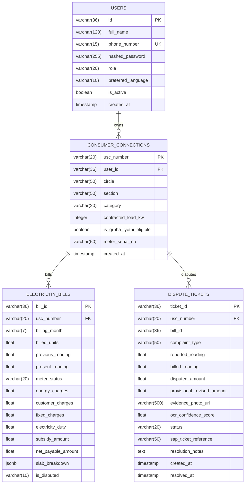

# UrjaMitra AI: Database Schema & Entity-Relationship Design
**Database Engine**: PostgreSQL 16  

---

## 1. Entity-Relationship Diagram

---

## 2. Indexing Strategy for 10,000+ Concurrent Queries

- `idx_connections_user`: B-tree index on `consumer_connections(user_id)` for citizen profile lookups in <2ms.
- `idx_bills_usc_month`: Composite B-tree index on `electricity_bills(usc_number, billing_month)` for instant invoice deconstruction.
- `idx_disputes_usc`: B-tree index on `dispute_tickets(usc_number)` for fast ticket resolution tracking.
