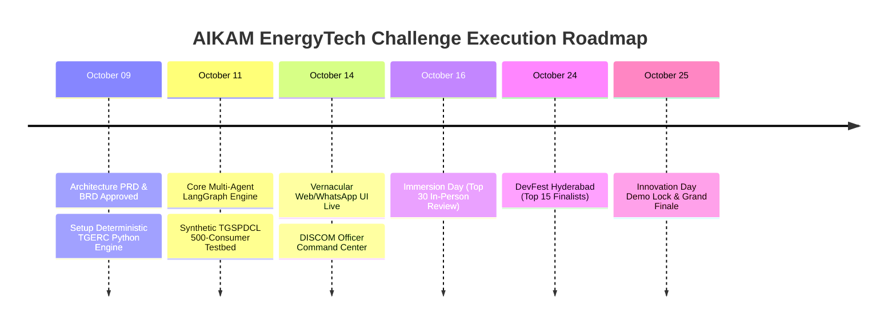

# 1. Product Overview & Executive Summary

## 1.1 Product Vision
**UrjaMitra AI** is a distributed, multi-agent AI copilot purpose-built for Telangana state electricity utilities (**TGSPDCL** and **TGNPDCL**). It solves consumer friction, reduces call center overhead on the state `1912` hotline by 65%, eliminates billing disputes via transparent mathematical deconstruction, and empowers 1.75 Crore citizens across Telangana with multilingual voice and conversational self-service in **Telugu, Hindi, and English**.

## 1.2 Core Architectural Axiom: Zero-Hallucination Deterministic Engine
In government utility billing, LLM hallucination on monetary amounts is intolerable. UrjaMitra AI strictly enforces the **Separation of Computation and Natural Language Interpretation**:
- **Natural Language & Intent Understanding**: Handled by LLM agents (LangGraph orchestrator).
- **Billing Arithmetic & Tariff Calculation**: Executed strictly by a **100% deterministic Python TGERC Tariff Engine** implementing exact gazette formulas.
- **RAG Regulatory Grounding**: Contextualized using official TGERC tariff orders and government subsidy rules (e.g., Gruha Jyothi scheme).

---

# 2. Deep Topic Indexing Matrix

| Topic ID | Component Specification | Scope Category | System Owner | Technical Deliverable | Target Phase |
| :--- | :--- | :--- | :--- | :--- | :--- |
| `PRD-01` | Architecture Tiers & Clean Design | Full-Stack Core | Solutions Architect | System Block Diagram & Microservices | Phase 1 |
| `PRD-02` | Multi-Agent Orchestration (LangGraph)| Agentic Framework | AI/ML Lead | Directed Acyclic Graph (DAG) State Engine | Phase 2 |
| `PRD-03` | Deterministic TGERC Calculation Engine| Core Algorithm | Backend Engineer | Python Tariff Engine (LT-I, LT-II, Gruha Jyothi) | Phase 2 |
| `PRD-04` | Multimodal OCR & Meter Vision Pipeline| Vision / Ingestion | Computer Vision Lead | Vision OCR Agent & Discrepancy Detector | Phase 2 |
| `PRD-05` | Multilingual Vernacular Voice/Chat UX | Frontend & Speech | UI/UX & Voice Lead | Web / WhatsApp / Voice Gateway (Telugu/Hindi) | Phase 3 |
| `PRD-06` | Data Schemas & Persistence Layer | Database & Cache | Data Architect | PostgreSQL 16 + pgvector + Redis Cache | Phase 3 |
| `PRD-07` | SAP IS-U / CRM Integration Gateway | Enterprise B2G | Integration Lead | REST/JSON Dispute Escalation Connectors | Phase 3 |
| `PRD-08` | FinOps & LLM Token Economics | Cost Governance | Cloud FinOps Lead | Multi-tier Model Routing & Token Budget | Phase 4 |

---

# 3. System Architecture & Component Hierarchy

```mermaid
graph TD
    subgraph Client Layer
        A1[Citizen Web App / Mobile Responsive]
        A2[WhatsApp Business Channel]
        A3[1912 Voice Call Bridge - WebRTC / SIP]
        A4[Utility Officer Command Dashboard]
    end

    subgraph API Gateway & Security
        B1[Kong / Envoy API Gateway]
        B2[Authentication & JWT / OTP Service]
        B3[Rate Limiting & DDOS Shield]
    end

    subgraph Agentic Orchestration Layer - LangGraph
        C0[Supervisor Router Agent]
        C1[Bill Deconstruction Agent]
        C2[OCR Vision & Audit Agent]
        C3[Consumption Spike & Solar Advisor]
        C4[SAP Dispute Ticket Agent]
    end

    subgraph Deterministic Domain Services
        D1[TGERC Tariff Calculation Engine - Python]
        D2[Gruha Jyothi Subsidy Validation Service]
        D3[Smart Meter Load Curve Analyzer]
        D4[Provisional Bill Adjustment Engine]
    end

    subgraph Data & Storage Layer
        E1[(PostgreSQL 16 - Consumer & Bills)]
        E2[(Qdrant / pgvector - TGERC Tariff RAG)]
        E3[(Redis Cluster - Session & Token Cache)]
        E4[(MinIO / S3 - Meter Photo & PDF Vault)]
    end

    subgraph External DISCOM Systems
        F1[TGSPDCL / TGNPDCL SAP IS-U CIS]
        F2[State Smart Meter MDMS Platform]
        F3[MeeSeva / Gruha Jyothi Subsidy DB]
    end

    Client Layer --> API Gateway & Security
    API Gateway & Security --> C0
    C0 --> C1
    C0 --> C2
    C0 --> C3
    C0 --> C4
    C1 --> D1
    C1 --> D2
    C2 --> D4
    C3 --> D3
    C4 --> F1
    Agentic Orchestration Layer - LangGraph --> Data & Storage Layer
```

---

# 4. Detailed Agent Specifications

## Agent 1: Bill Deconstruction & Telescopic Slab Agent
- **Purpose**: Decompose confusing monthly electricity bills into crystal-clear line items, explaining exactly how slab brackets apply.
- **Inputs**: Unique Service Number (USC No), billing period, units consumed.
- **Workflow**:
  1. Retrieve consumer category (e.g., LT-I(A), LT-I(B), LT-II Commercial) and contracted load from PostgreSQL.
  2. Invoke `TGERC_Tariff_Engine.calculate_bill(units, category, contracted_load)`.
  3. Formulate empathetic, conversational explanation in citizen's chosen language (Telugu/English).
  4. Compare with previous month's bill to identify exact variance factors (e.g., seasonal heat, slab threshold crossing).

## Agent 2: Multimodal Bill OCR & Meter Reading Audit Agent
- **Purpose**: Ingest uploaded images/PDFs of physical bills or meter LCD displays, extract numerical readings, and identify discrepancies.
- **Inputs**: Image file or PDF stream.
- **Workflow**:
  1. Image preprocessing (contrast enhancement, perspective correction).
  2. Vision OCR extraction of key attributes: USC No, Billing Date, Previous KWh, Present KWh, Meter Status (01 Normal, 02 Door Lock, 03 Defective).
  3. Validate mathematical consistency:
     $$\text{Calculated Units} = \text{Present Reading} - \text{Previous Reading} \times \text{MF (Multiplying Factor)}$$
  4. If status is `02 (Door Lock)` or `Average Billing`, compare with consumer's live meter photo. If actual meter reading is lower than billed reading, trigger dispute workflow.

## Agent 3: Proactive Consumption & Spike Advisory Agent
- **Purpose**: Prevent future bill shocks, detect unusual load curves, and recommend actionable energy-saving measures.
- **Inputs**: Hourly smart meter readings or 12-month historical consumption.
- **Workflow**:
  1. Cluster consumption by Time-of-Day (ToD): Morning Peak (06:00-10:00), Solar Hours (10:00-17:00), Evening Peak (18:00-22:00), Night Baseload (22:00-06:00).
  2. Calculate slab proximity warning:
     $$\Delta_{\text{subsidy}} = 200 - \text{Current Month Projected Units}$$
  3. If $\Delta_{\text{subsidy}} < 15\text{ units}$, send urgent WhatsApp/SMS advisory with targeted advice: *"You have used 188 units with 4 days remaining. Switching off secondary geysers will save you ₹1,200 under Gruha Jyothi."*
  4. Rooftop Solar Feasibility: Compute solar generation potential under PM Surya Ghar Muft Bijli Yojana.

## Agent 4: Autonomous Dispute Resolution & SAP Ticket Agent
- **Purpose**: Autonomously resolve legitimate billing calculation errors or escalate unresolvable anomalies with structured audit packages.
- **Workflow**:
  1. Verify evidence completeness (meter photo timestamp, GPS geo-tag if available, OCR reading confidence $> 92\%$).
  2. Generate **Provisional Revised Bill** according to TGERC dispute guidelines.
  3. Construct a standard SAP IS-U BAPI complaint payload:
     ```json
     {
       "service_connection_no": "100234891",
       "circle": "Hyderabad South",
       "complaint_type": "BILLING_METER_READING_MISMATCH",
       "reported_reading": 14210,
       "billed_reading": 14850,
       "delta_kwh": -640,
       "disputed_amount_inr": 4820.00,
       "provisional_revised_amount_inr": 1940.00,
       "evidence_photo_url": "https://vault.tgspdcl.gov.in/disputes/100234891_oct26.jpg",
       "ocr_confidence_score": 0.965,
       "recommended_action": "REVISE_BILL_CREDIT_ADJUSTMENT"
     }
     ```
  4. Post to DISCOM SAP gateway with Human-in-the-Loop review for the Section Officer (AAE).

---

# 5. Deterministic TGERC Tariff Engine Specification

The core tariff engine implements Telangana State Electricity Regulatory Commission (TGERC) Retail Supply Tariff formulas without approximations:

### LT Category-I (Domestic) Slab Table:
```
Sub-Category A (Total consumption <= 100 Units/Month):
  - 0 to 50 Units:     ₹1.95 / Unit
  - 51 to 100 Units:   ₹3.10 / Unit

Sub-Category B (Total consumption 101 to 200 Units/Month):
  - 0 to 100 Units:    ₹3.40 / Unit
  - 101 to 200 Units:  ₹4.80 / Unit

Sub-Category C (Total consumption > 200 Units/Month - Telescopic):
  - 0 to 100 Units:    ₹5.10 / Unit
  - 101 to 200 Units:  ₹7.70 / Unit
  - 201 to 300 Units:  ₹9.00 / Unit
  - 301 to 400 Units:  ₹9.50 / Unit
  - 401 to 800 Units:  ₹10.00 / Unit
  - Above 800 Units:   ₹11.00 / Unit
```
- **Fixed Charges**: ₹10 to ₹15 per kW/month depending on contracted load.
- **Customer Charges**: Scaled from ₹40 to ₹80 per month based on consumption band.
- **Electricity Duty (ED)**: ₹0.06 per unit billed.
- **Gruha Jyothi Subsidy**: If domestic consumer is tagged eligible and total consumption $\le 200\text{ units}$, total bill is zeroed via State Government Subsidy credit.

---

# 6. Vernacular Voice & Chat Experience (Telugu-First)

1. **ASR (Speech-to-Text)**: Optimized for Telangana Telugu dialects (Telangana slang, mixed Telugu-English like "నా బిల్లు ఎందుకు ఎక్కువ వచ్చింది?", "meter photo upload చేయాలా?").
2. **Translation & Dialogue Routing**: Fast bilingual translation using Gemini 2.5 Flash / Claude 3.5 Haiku, caching localized responses.
3. **TTS (Text-to-Speech)**: High-naturalness Telugu neural TTS generating audio messages for WhatsApp voice notes and telephony IVR playback.

---

# 7. LLM Token Economics & Cost Projections

### 7.1 Tiered Model Routing Strategy
- **Tier 1 (Complex Reasoning & Dispute Audit)**: Gemini 2.5 Pro / Claude 3.7 Sonnet (Used for complex dispute auditing and vision analysis — 15% of queries).
- **Tier 2 (Conversational Dialogue & Translation)**: Gemini 2.5 Flash / Claude 3.5 Haiku (Used for everyday Q&A and translation — 85% of queries).
- **Tier 3 (Mathematical Engine)**: Local Python Microservice (0 LLM tokens, 100% deterministic).

### 7.2 Token Economics & Monthly Cost Matrix

| Scale Tier | Daily Active Users (DAU) | Monthly Inquiries | Prompt Tokens / Query | Completion Tokens / Query | Est. Monthly LLM Cost (USD) | Est. Monthly LLM Cost (INR) |
| :--- | :--- | :--- | :--- | :--- | :--- | :--- |
| **Pilot (1 Circle)** | 1,500 | 45,000 | 850 (Cached: 600) | 180 | $38.50 | **₹3,200** |
| **City Scale (Hyd)** | 35,000 | 1,050,000 | 850 (Cached: 600) | 180 | $890.00 | **₹74,000** |
| **Full State Scale** | 250,000 | 7,500,000 | 850 (Cached: 600) | 180 | $6,350.00 | **₹5,27,000** |

*Prompt caching reduces system prompt token costs by up to 78%, ensuring scalable economics well within state utility budgets.*

---

# 8. Non-Functional & Enterprise Security Requirements

1. **Security & DPDP Act 2023 Compliance**:
   - Zero storage of unencrypted consumer Aadhaar / Bank details.
   - All consumer phone numbers and meter serial numbers pseudonymized in analytical logs.
   - Role-Based Access Control (RBAC) with audit trail for DISCOM section officers.
2. **High Availability & Latency Targets**:
   - End-to-end Chat Response Latency: $p95 < 1.8\text{ seconds}$.
   - Voice Synthesis Streaming Latency: First audio chunk $< 650\text{ ms}$.
   - System Uptime SLA: 99.95% on sovereign cloud infrastructure.
3. **Auditability**:
   - Every dispute ticket generated by Agent 4 includes full cryptographic provenance (hash of source image, OCR tokens, timestamp, engine version).

---

# 9. AIKAM Challenge Milestone Execution Plan



---
*Project: UrjaMitra AI | Dandothkar Manik Prabhu | Digio Click | Page 1 of 1 | Experience: 5.4 Years*
